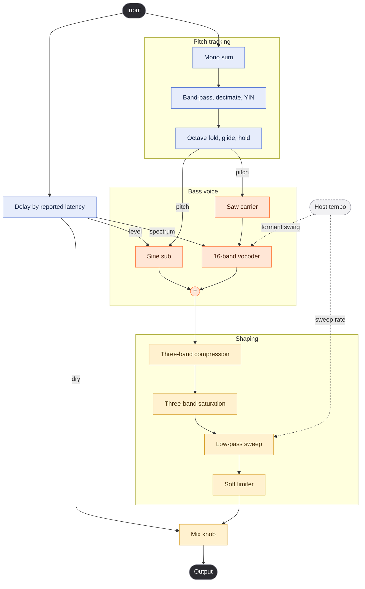

# Bassment

A VST3 effect that turns monophonic audio (a vocal, a lead, drums) into a heavy, growling bass. It has one knob, Mix, between the input and the bass. Windows only.

It is inspired by the Bassify Ableton rack, a separate commercial product. This project is not affiliated with it and has no relation to its code.

## How it works



Pitch estimates trail the input by about 30 ms, so the dry signal and the vocoder's modulator are delayed to match, and that delay is reported to the host. The formant swing runs once per beat and the low-pass sweep once per eighth note.

| Block | File |
|---|---|
| Band-pass, crossovers, shared filters | `src/dsp/Filters.h` |
| YIN detector | `src/dsp/PitchDetector.h` |
| Octave fold, glide, hold | `src/dsp/PitchTracker.h` |
| Saw and sine oscillators | `src/dsp/SubOscillator.h` |
| Vocoder | `src/dsp/Vocoder.h` |
| Level follower | `src/dsp/EnvelopeFollower.h` |
| Compression | `src/dsp/Ott.h` |
| Saturation | `src/dsp/MultibandDrive.h` |
| Low-pass sweep | `src/dsp/Growl.h` |
| Chain, parameters, state | `src/BassmentProcessor.cpp` |

## Build

Requirements: Windows, CMake 3.22 or newer, Ninja, and the MSVC C++ build tools. MinGW cannot build JUCE. JUCE 9.0.4 is fetched on the first configure.

From a shell where MSVC is on the path (a Developer PowerShell, or after `vcvars64.bat`):

```
cmake -B build -G Ninja -DCMAKE_BUILD_TYPE=Release -DCMAKE_C_COMPILER=cl -DCMAKE_CXX_COMPILER=cl
cmake --build build
```

Output is in `build/BassmentVST_artefacts/Release/`: `VST3/Bassment.vst3` and `Standalone/Bassment.exe`. Copy the `.vst3` folder to `C:\Program Files\Common Files\VST3\` and rescan in your DAW. The standalone mutes its input at first to avoid feedback, so use a DAW to hear it on real audio.

## Tests

The DSP checks need no JUCE and build in seconds:

```
cmake -B build -G Ninja -DCMAKE_BUILD_TYPE=Release -DBASSMENT_BUILD_TESTS=ON
cmake --build build
ctest --test-dir build
```

They cover the pitch detector and tracker, the vocoder, and the compressor, on synthetic signals. They do not cover the full plugin, the sound, or recorded vocals.

## Layout

```
CMakeLists.txt
src/
  BassmentProcessor.*   parameters, state, signal chain, fixed voicing constants
  ui/                   editor and look and feel
  dsp/                  one header per DSP block
tests/                  offline DSP checks
```

## Working on it

- The sound is fixed constants at the top of `src/BassmentProcessor.cpp`, not parameters. The only parameter is `mix`.
- Parameter IDs are permanent once released, because renaming one breaks saved projects. The plugin code is `Bsmt` and JUCE needs exactly four characters.
- Nothing allocates or locks on the audio thread. Everything is sized in `prepareToPlay`.
- The DSP blocks except `MultibandDrive` and `Growl` are plain C++ with no JUCE, so they can be tested offline. A new block with logic in it gets a test in `tests/`, registered in the `foreach` in `CMakeLists.txt`.

## Status

Builds and passes its offline tests. It has not been run through pluginval, measured for CPU, or checked in a DAW with real audio. The compressor thresholds, output trim, sweep depth and formant swing depth are estimates, not tuned by ear.

## Licence

The source is MIT, see `LICENSE`. The plugin is built on JUCE, which is AGPLv3 or a paid commercial licence, so a distributed binary also has to follow JUCE's terms.
